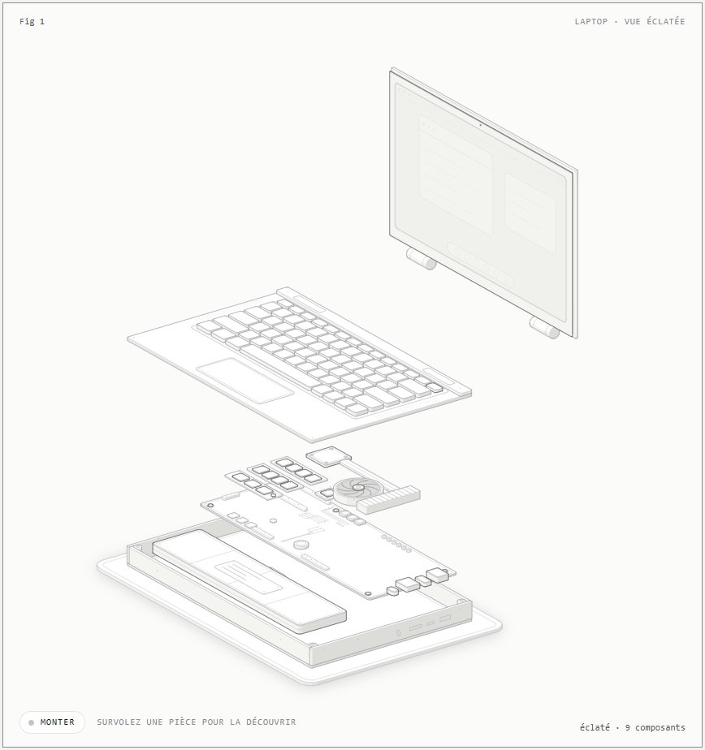
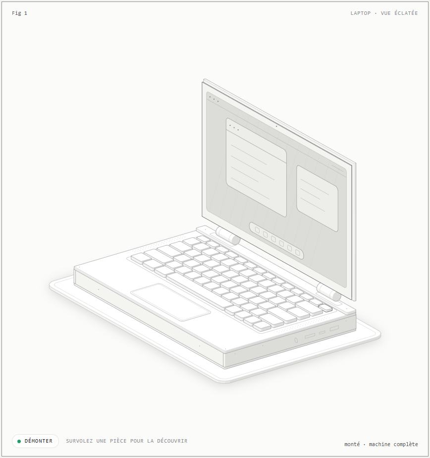
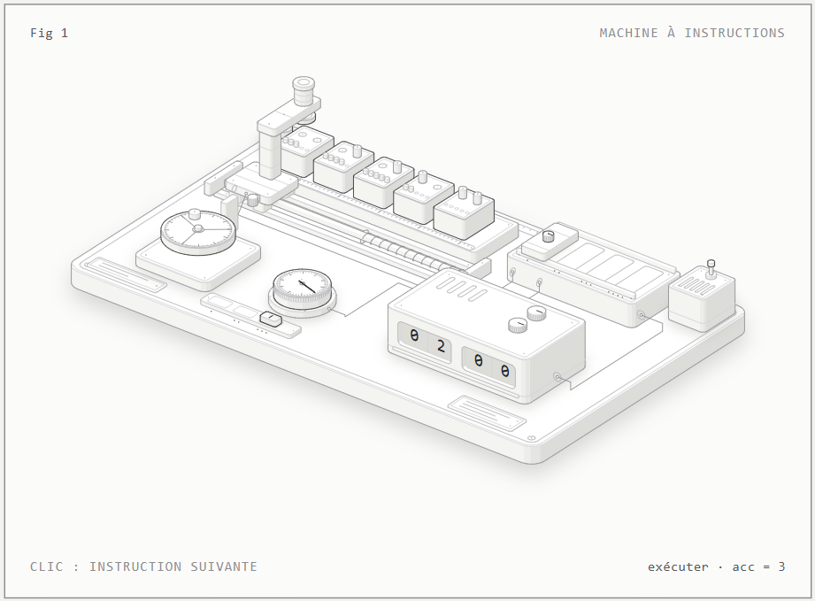

# Anatomie d'un ordinateur

*[English version → README.en.md](README.en.md)*

Deux figures **isométriques et interactives** qui expliquent le fonctionnement d'un ordinateur en montrant des objets réels, pas des schémas à flèches :

| Figure | Ce qu'elle explique |
|---|---|
| **Machine à instructions** | Le cycle d'un processeur : *chercher* une instruction en mémoire, la *décoder*, l'*exécuter*. Une tête de lecture, un décodeur, un registre à deux fenêtres et un volant d'horloge font tourner un vrai petit programme (3 + 4 + 5 − 2 = 10). |
| **Laptop en vue éclatée** | Les 9 composants d'un ordinateur portable (coque, batterie, carte mère, processeur, mémoire vive, SSD, refroidissement, clavier, écran), que l'on peut **monter un par un** jusqu'à obtenir la machine complète. |

Chaque figure est **un seul fichier HTML autonome** : pas de serveur, pas de dépendance, thème clair et sombre.





## Voir les figures

Ouvrez directement un fichier de [`docs/`](docs/) dans votre navigateur (double-clic) :

- [`docs/laptop-light.html`](docs/laptop-light.html) · [`docs/laptop.html`](docs/laptop.html) (sombre)
- [`docs/machine-a-instructions-light.html`](docs/machine-a-instructions-light.html) · [`docs/machine-a-instructions.html`](docs/machine-a-instructions.html) (sombre)

**En ligne avec GitHub Pages** : dans le dépôt, *Settings → Pages → Build and deployment → Deploy from a branch → `main` / dossier `/docs`*. La page d'accueil est [`docs/index.html`](docs/index.html).

## Utilisation

### Laptop en vue éclatée
- **Survolez** une pièce, ou cliquez sa pastille numérotée sous la figure : la pièce s'éclaire et son rôle s'affiche.
- **Monter** pose les pièces dans l'ordre, une toutes les 1,7 s ; le bouton devient **Pause**, puis **Démonter** une fois la machine complète (l'écran s'allume).
- Clavier : `Espace` ou `Entrée` monter/démonter, `←` `→` parcourir les pièces, `Échap` désélectionner.
- Sans interaction, la figure joue seule un montage puis un démontage, en boucle.

### Machine à instructions
- **Clic**, `Entrée` ou `→` : passer à l'instruction suivante. `Espace` : pause.
- Le texte en bas à droite indique la phase (*chercher*, *décoder*, *exécuter*) et le calcul en cours.

## Intégrer une figure dans votre site

Copiez le fichier HTML voulu, puis :

```html
<iframe src="laptop-light.html" title="Laptop en vue éclatée"
        width="900" height="1100" loading="lazy" style="border:0"></iframe>
```

## Reconstruire depuis les sources

Prérequis : **Node.js 20.10 ou plus récent**. Google Chrome ou Chromium n'est nécessaire que pour les vérifications et les captures d'écran.

```bash
git clone https://github.com/<votre-utilisateur>/anatomie-ordinateur.git
cd anatomie-ordinateur

npm run build:machine        # machine à instructions (quelques secondes)
npm run build:laptop:fast    # laptop, ordre de dessin approximatif (~15 s) : pour itérer
npm run build:laptop         # laptop, version finale (~6 min par thème)
```

Les fichiers sont écrits dans `docs/`. Il n'y a **aucune dépendance npm** à installer.

> Pourquoi 6 minutes ? Le laptop contient 85 pièces qui bougent. Le build mesure, pour chaque paire de pièces qui se recouvrent à l'écran, laquelle est devant, dans près de 1 000 positions du montage, puis en déduit l'ordre de dessin. Le mode `--fast` saute cette mesure : utile pour essayer, à ne pas publier.

### Vérifications de qualité

```bash
npm run audit:laptop   # audit géométrique complet : doit se terminer par « audit passed »
npm run check          # contrôle que chaque trait aboutit sur quelque chose (nécessite Chrome)
```

L'audit vérifie, sur le laptop, qu'aucune pièce n'en traverse une autre (montée, éclatée et en mouvement), que chaque pièce repose sur une autre, et que l'ordre de dessin est juste dans toutes les positions.

## Structure du dépôt

```
docs/                        figures prêtes à l'emploi (HTML autonomes) + index.html
assets/                      captures d'écran du README
figures/
  machine-a-instructions/    build.mjs (dessin) + model.mjs (modèle animé)
  laptop/                    build.mjs (pièces, mouvements) + live.js (interaction) + laptop.css
kit/                         moteur isométrique (voir NOTICE.md)
scripts/                     construction de page, captures, contrôle des traits (voir NOTICE.md)
checks/                      scénarios de vérification (npm run check)
```

## Créer votre propre figure

**À la main.** Copiez `figures/laptop/` vers `figures/ma-figure/` puis, dans `build.mjs` :

1. Décrivez les assemblages dans `PIECES` : un nom, une phrase d'explication (`say`, `desc`) et un vecteur d'éclatement `move`.
2. Donnez `ORDER` (de bas en haut, c'est l'ordre de montage) ; `STAGGER` en est l'inverse.
3. Dessinez les pièces avec `slabPart` (boîtes), `cylPart` (cylindres) ou `put` (formes libres). Chaque pièce **enregistre sa forme réelle** : c'est ce qui permet à l'audit de vérifier le dessin.
4. Lancez `node figures/ma-figure/build.mjs --light --fast`, ouvrez `docs/` et itérez.
5. Pour finir : build complet puis `--audit`, qui doit se terminer par `audit passed`.

Règles qui font la différence : une pièce posée sur une autre n'y est jamais enfoncée ; chaque trait aboutit sur une arête, un point ou un contour ; une pièce qui monte ne doit jamais en traverser une autre.

**Avec Claude Code.** Le moteur vient du skill *anatomy*. Une fois installé, vous pouvez décrire la figure voulue en français :

```bash
npx skills add wheresryan22/anatomy
```

> Un skill peut contenir des scripts : lisez son contenu avant de l'installer. Ensuite, demandez par exemple : « Avec le skill anatomy, fais une vue éclatée interactive d'une carte graphique. » Le dépôt du skill documente toutes les règles de dessin.

## Limites connues

- Les descriptions des composants donnent des ordres de grandeur génériques (par exemple « 50 à 70 Wh » pour la batterie), pas ceux d'un modèle précis.
- La vue reste vue de dessus à angle fixe : les pièces du dessous sont partiellement cachées par celles du dessus, comme dans tout éclaté ; la sélection permet de les repérer.
- Le thème sombre a un contraste volontairement discret ; le thème clair est le thème de référence.

## Crédits et licence

- Code des figures : licence **MIT** (voir [`LICENSE`](LICENSE)).
- Moteur isométrique (`kit/`, une partie de `scripts/`) : **Anatomy** de [wheresryan22](https://github.com/wheresryan22/anatomy), licence MIT, © 2026 Ryan. Détails dans [`NOTICE.md`](NOTICE.md).
